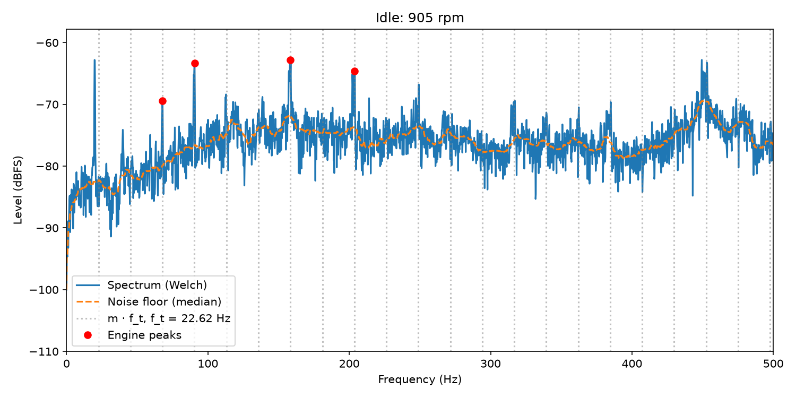
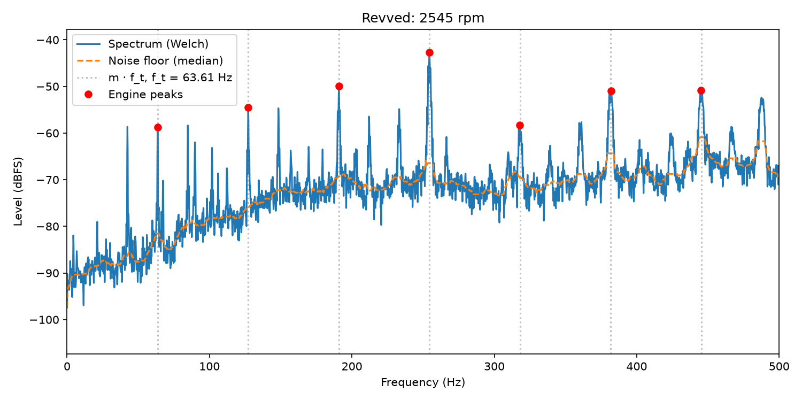

# Car scanner

Estimating a car engine's speed from a phone recording of its sound, using classic signal analysis.

The demo listens to a three-cylinder Hyundai i10 at idle and at about 2500 rpm, finds the engine's harmonics in the spectrum, and calculates the engine speed without being told what it is. The result is then checked against the car's rev counter.

| Recording | Estimated by the code | Rev counter |
|---|---|---|
| Idle | 905 rpm | 900 rpm |
| Revved | 2545 rpm | approx. 2500 rpm |

This is the first of three planned projects. It is a **measurement, not a diagnosis**.

---

## 1. Motivation

My background is in audiology, followed by master's level courses in engineering acoustics at DTU, and later software development. Sound has always been the thread running through it.

This project started as a way to revisit DTU course 30160 (signal analysis) properly, not just reading the textbook again, but using it on something real. A car engine is a good test case: it is a periodic sound source, the physics behind its frequencies is simple and well known, and the result can be checked independently with the rev counter. If the theory is right, the spectrum should show it.

Building it also meant turning the theory into a small, clean code base, where every class has one job and every step can be tested with signals where the answer is known in advance.

---

## 2. Theory

### 2.1 The engine as a sound source

In a four-stroke engine each cylinder fires once every second revolution. With $c$ cylinders firing evenly:

$$f_k = \frac{\text{rpm}}{60} \qquad\qquad f_t = f_k \cdot \frac{c}{2}$$

$f_k$ is the crankshaft frequency and $f_t$ the firing frequency. For three cylinders $f_t = 1.5 \cdot f_k$, so

$$\text{rpm} = f_t \cdot 60 \cdot \frac{2}{3} = 40 \cdot f_t$$

| Engine speed | $f_k$ | $f_t$ |
|---|---|---|
| 900 rpm (idle) | 15 Hz | 22.5 Hz |
| 2500 rpm | 41.7 Hz | 62.5 Hz |

### 2.2 Why the spectrum has harmonics

Each firing is a short pressure pulse, so the engine produces a periodic pulse train. By the Fourier series, a signal with period $T_0$ only contains frequencies at multiples of $f_0 = 1/T_0$:

$$f = m \cdot f_0, \qquad m = 1, 2, 3, \dots$$

For the engine, $f_0 = f_t$, so the spectrum shows peaks at $f_t, 2f_t, 3f_t, \dots$

**Half orders.** If all three cylinders sounded exactly alike, only these peaks would appear. In practice they differ slightly (compression, fuel, combustion), so the pattern only repeats after a full engine cycle of two revolutions. That adds peaks at multiples of the half order $f_k/2$. They become clearer at higher engine speed, where the combustions are stronger.

### 2.3 From samples to spectrum

The recording is sampled at $f_s = 48\,000$ Hz. A recording of $N$ samples lasts $T = N/f_s$. The discrete Fourier transform

$$F(m) = \sum_{n=0}^{N-1} f(n)\, e^{-j\frac{2\pi}{N}mn}$$

gives lines spaced $f_0 = 1/T$ apart, and a baseband from 0 to $f_s/2$. Two choices matter:

- **Hanning window.** The DFT treats the recording as if it repeats. Unless it contains a whole number of engine periods, there is a jump where the end meets the start, which smears energy into neighbouring frequencies (leakage). The Hanning window tapers both ends to zero. The price is a wider main peak.
- **Welch averaging.** The recording is split into 5 s pieces ($f_0 = 0.2$ Hz), each piece gets its own spectrum, and the power is averaged. Noise is random and averages towards a smooth floor, while the engine's peaks are in every piece and stay. The floor's fluctuations shrink by about $1/\sqrt{K}$ for $K$ pieces.

Amplitudes are scaled so a sine with amplitude $A$ shows as $A$, independent of recording length and window:

$$A_m = \frac{2\,|F(m)|}{N \cdot \bar{w}}$$

where $\bar{w}$ is the window's mean.

### 2.4 Decibels

Levels are shown in dB relative to full scale (dBFS). Decibel is defined for power, and power is amplitude squared:

$$L = 10\log_{10}\!\left(\frac{A^2}{A_{ref}^2}\right) = 20\log_{10}\!\left(\frac{A}{A_{ref}}\right), \qquad A_{ref} = 1$$

A factor 10 in amplitude is always 20 dB, so weak and strong peaks can be compared in the same plot.

### 2.5 Noise floor and peaks

The noise floor is not flat: the phone's microphone is weak below about 100 Hz, so the floor rises at low frequencies. It is estimated with a **running median** over 10 Hz. The median ignores narrow peaks as long as they fill less than half of the window, and follows slower changes in the floor.

Each line is then measured in dB above the floor, much like an audiogram in dB HL uses normal hearing at each frequency as its reference. A peak must be a local maximum at least **8 dB above the floor**, and peaks must be at least 2 Hz apart.

### 2.6 Finding the engine speed: a harmonic comb

The code tries candidate firing frequencies in steps of 0.01 Hz. For each candidate it counts how many peaks lie within 0.5 Hz of a tooth $m \cdot f_t$. The candidate that hits most peaks wins. Each matched peak then gives its own estimate $f_{peak}/m$, and their mean is the final $f_t$.

**The expected range.** A comb at $f_t/2$ or $f_t/3$ hits every tooth of the real comb as well. From the peaks alone, the code cannot tell which order it has found (an octave error). The user therefore gives a rough expected range, for example idle or revved. For three cylinders the crankshaft order sits at $\tfrac{2}{3} f_t$, so to exclude it safely:

$$\frac{\text{rpm}_{max}}{\text{rpm}_{min}} < 1.5$$

---

## 3. Results





**How to read the plots.** The blue line is the spectrum, the dashed line the noise floor, the grey dotted lines the comb teeth $m \cdot f_t$, and the red dots the peaks the code assigned to the engine.

### What the results show

- **Idle.** Peaks at 67.8, 90.6, 158.2 and 203.8 Hz, the 3rd, 4th, 7th and 9th harmonics of $f_t = 22.62$ Hz. That gives 905 rpm against 900 on the rev counter.
- **Revved.** Seven harmonics in a row from 63.6 Hz, $f_t = 63.61$ Hz, giving 2545 rpm against about 2500.
- **The pattern scales with engine speed.** The same structure appears in both recordings, stretched by the ratio of the engine speeds.
- **The comb ignores what does not fit.** At idle, the strong peak at 19.8 Hz is left out because it is not on a tooth. When revved, the strong peaks between the teeth are half orders and are left out as well.
- **The microphone matters.** At idle the fundamental at 22.6 Hz is missing, because it is below what the phone hears well. When revved, the fundamental at 63.6 Hz is visible.

### What the results do not show

- **Engine health.** There is no sign of a fault, but there is no reference either. Without recordings of this engine known to be healthy, and data with known faults, the code cannot say what is normal.
- **The source of the 19.8 Hz peak.** It is only present at idle and does not follow the engine speed in an obvious way.
- **Precise absolute levels.** dBFS depends on the phone, its placement and possible automatic gain. Levels can be compared within this setup, not with other setups.
- **Generality.** One car, one phone, two engine speeds. The method is general, the settings are tuned to these recordings.

### Known limitations

| Limitation | Effect |
|---|---|
| Phone microphone | Weak below about 100 Hz. The engine is seen mostly in its harmonics |
| OGG recordings | Lossy compression. The highest frequencies are almost removed |
| Expected range required | Too wide a range gives octave errors, for example 1696 instead of 2545 rpm |
| Peaks at 4, 8 and 10 kHz | Round numbers, most likely from the phone or app, not the engine |
| Rev counter | Analogue needle, read by eye |

---

## 4. Next steps

- **Tests** in `tests/` with synthetic signals, so pytest checks every class.
- **OperatingContext**, a small class holding the expected range, as in the class diagram.
- **Penalty for missing teeth** in the comb, to reduce the need for an expected range.
- **Overlap in Welch** (50 %), giving almost twice as many pieces and a smoother floor.
- **Spectrogram** of the recording with varying engine speed, showing the peaks move over time.
- **WAV or FLAC recordings**, and a microphone with better low-frequency response.
- **Diagnosis at idle** (project 2): reference recordings of a healthy engine and data with known faults, for example compared with the car's OBD log.
- **Diagnosis while driving** (project 3): wheels, bearings and gearbox, where the frequencies change over time.

---

## Project structure

```
src/bilscanner/
├── models/       data classes: Signal, Spectrum, Peak, EngineModel
├── sources/      where signals come from: AudioLoader, SignalGenerator
├── analysis/     window, spectrum, Welch, noise floor, peaks, comb
├── plotting/     Plotter
└── carScanner.py the whole chain in one call
scripts/          check scripts and the demo
```

## Running the demo

```
python -m venv .venv
.venv\Scripts\Activate.ps1
pip install -r requirements.txt
pip install -e .
python scripts/demo.py
```

The recordings are in `data/` and are not part of the repository.
